# Capstone Week Two — End-to-End CI/CD on AWS

## Contents
- `src/`: Express app and npm manifest
- `src/tests/`: Jest + Supertest unit/integration tests
- `Dockerfile`: non-root Node.js container
- `buildspec.yml`: test, build, push to ECR, publish `imageDetail.json`
- `taskdef.json`: CodePipeline CodeDeployToECS task-definition template
- `appspec.yml`: ECS CodeDeploy AppSpec template
- `pipeline-diagram.png`: architecture diagram

## Required AWS names used by this project
- ECR repository: `myapp-repo`
- ECS cluster: `myapp-cluster`
- ECS service: `myapp-service`
- ECS task family: `myapp-task`
- container: `myapp-container`
- CodeBuild project: `myapp-build`
- CodeDeploy application: `myapp-codedeploy`
- CodeDeploy deployment group: `myapp-deployment-group`
- CodePipeline: `myapp-pipeline`
- CloudWatch log group: `/ecs/myapp`

## Before deployment
1. Replace `ACCOUNT_ID` and `AWS_REGION` in `taskdef.json` with the actual account ID and region.
2. In CodeBuild, set `AWS_DEFAULT_REGION` to the same region and grant the CodeBuild role ECR push permissions.
3. Create the ECR repository and push an initial image/build before creating the first ECS service.
4. Create an ECS Fargate service configured for **CodeDeploy** deployments, an Application Load Balancer, two target groups, and production plus test listeners.
5. Configure the CodeDeploy deployment group against that ECS service and both target groups.
6. In CodePipeline, use GitHub (via CodeConnections) as source, CodeBuild output as build artifact, a Manual approval action, then **CodeDeployToECS** as deploy action. Set `TaskDefinitionTemplatePath=taskdef.json`, `AppSpecTemplatePath=appspec.yml`, `Image1ArtifactName=BuildArtifact`, and `Image1ContainerName=myapp-container` (use the exact artifact name you configured).
7. Configure CloudWatch alarms and SNS notifications as described in your project guide.

## Important pipeline note
The CodeDeployToECS action expects `imageDetail.json` with an `ImageURI` property and replaces `<IMAGE1_NAME>` in `taskdef.json` and `<TASK_DEFINITION>` in `appspec.yml`. Do not use the standard ECS `imagedefinitions.json` format for this blue/green CodeDeploy action.

## Run locally
From the repository root:
```bash
cd src
npm install
npm test
cd ..
docker build -t myapp-local .
docker run --rm -p 3001:3001 myapp-local
```
Visit `http://localhost:3001/` and `http://localhost:3001/health`.

---

## Pipeline diagram showing your final pipeline flow.

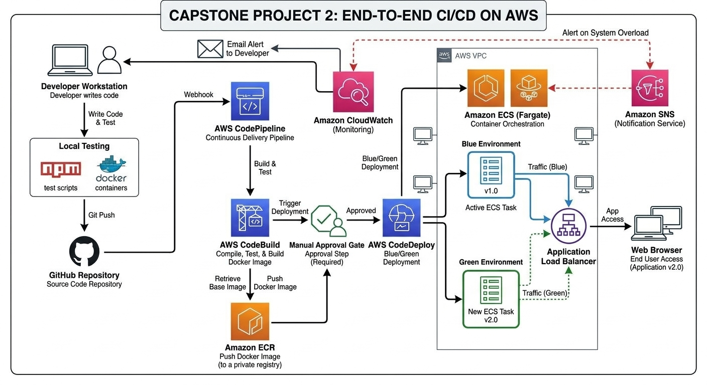

---

## Screenshots

### 1. CodeBuild builds and pushes Docker image to ECR.


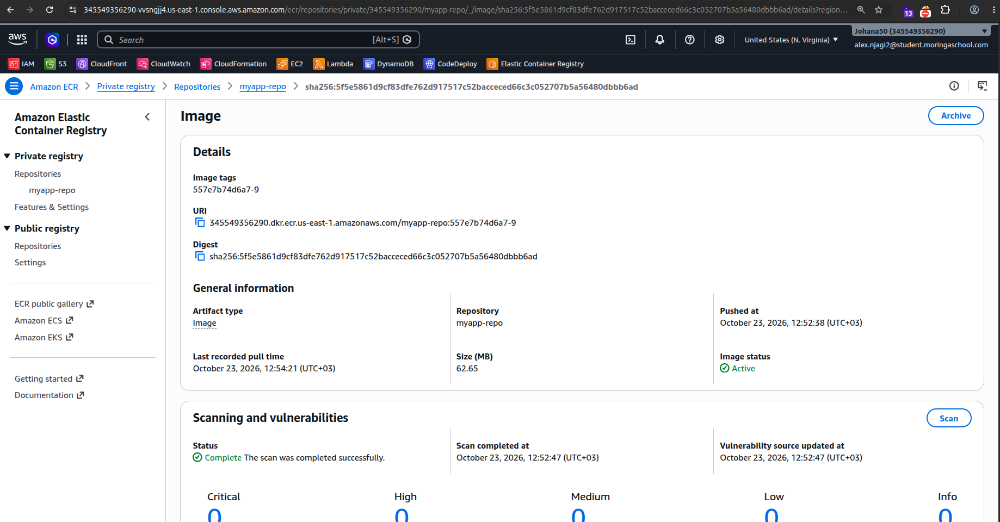

---

### 2. CodeDeploy updates ECS task definition and triggers ECS deployment.

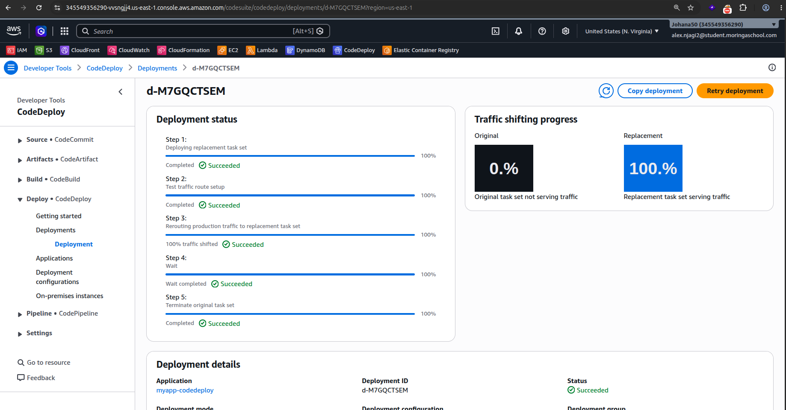

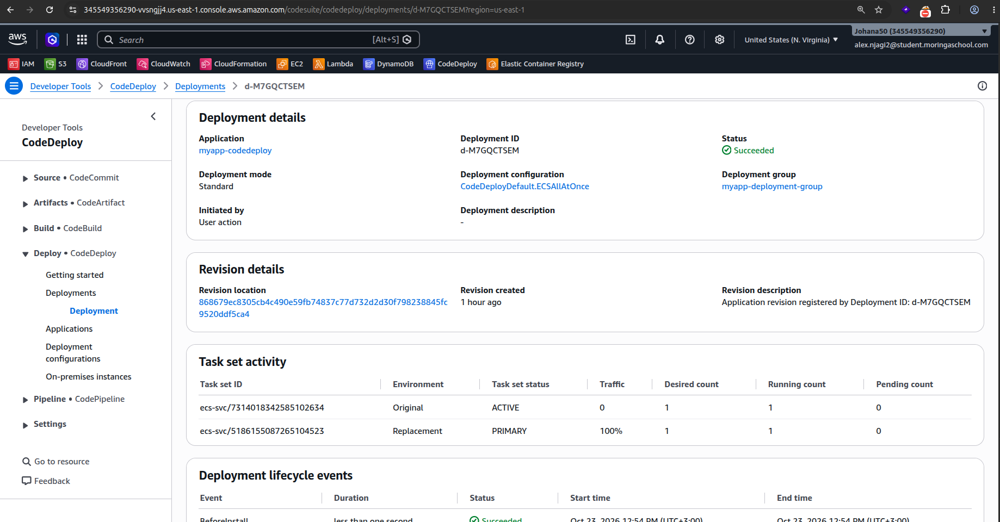

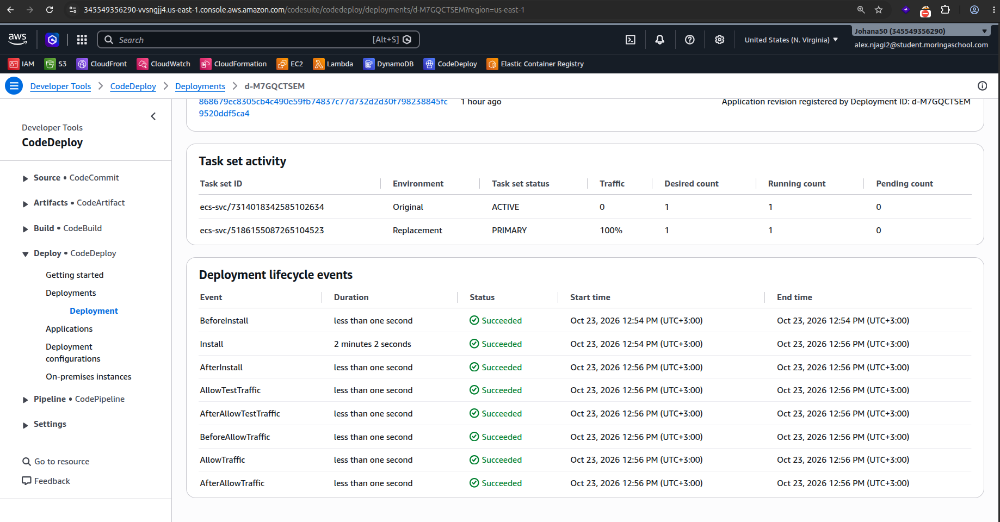

---

### 3. Manual approval before production.

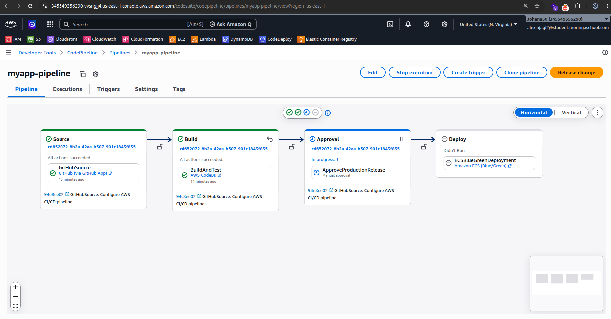

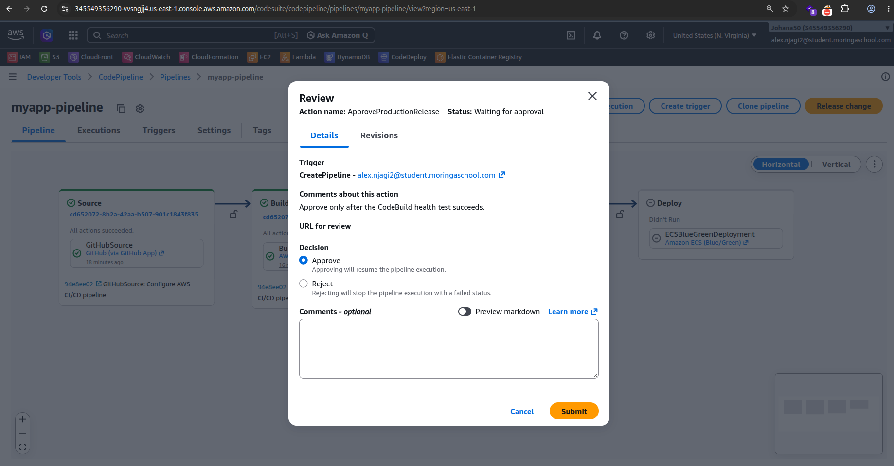

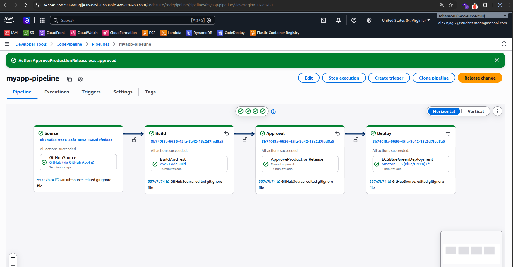

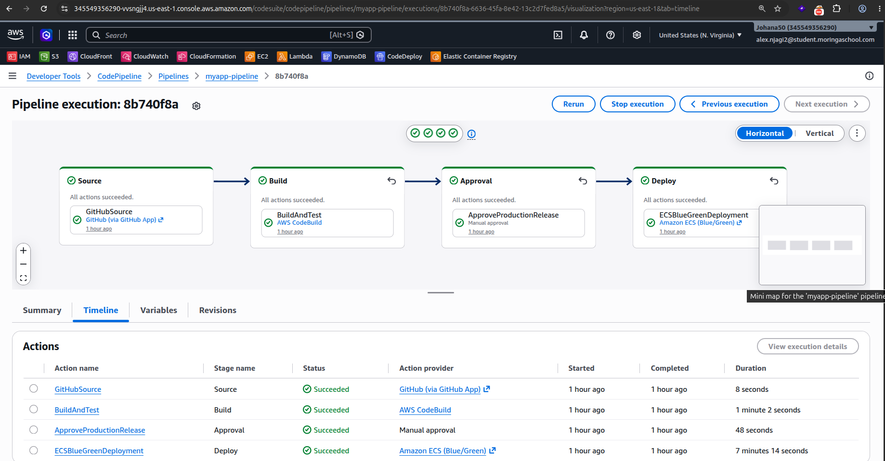

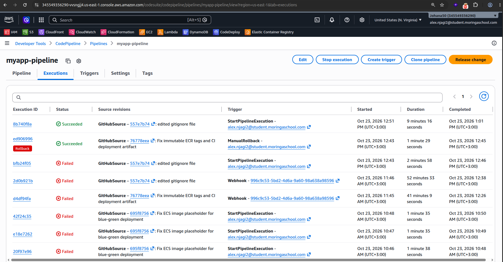

---

### 4. View of the website image pushed to production

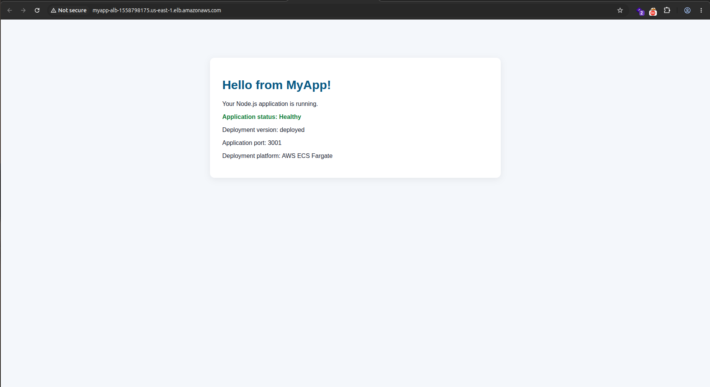

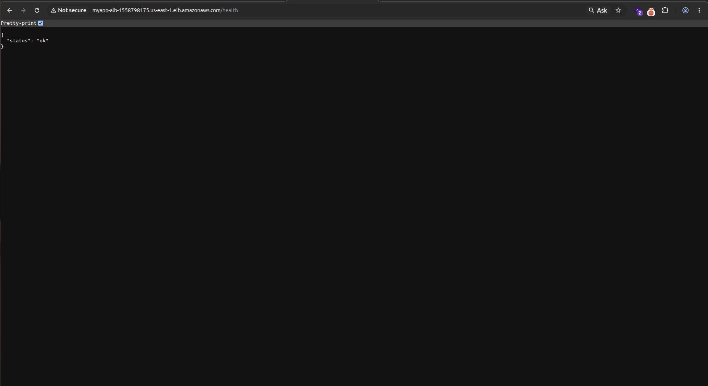

---

### 5. View of the website image pushed running on localhost

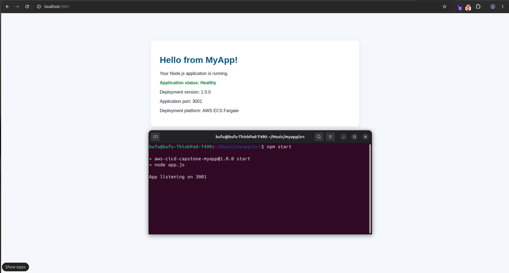

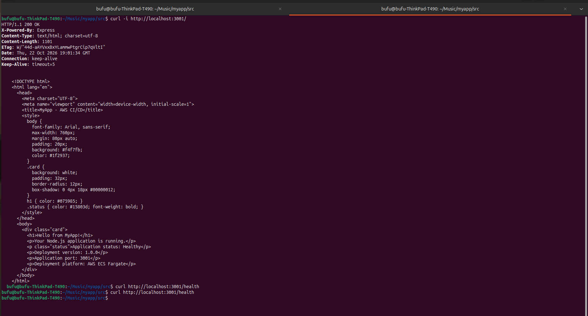

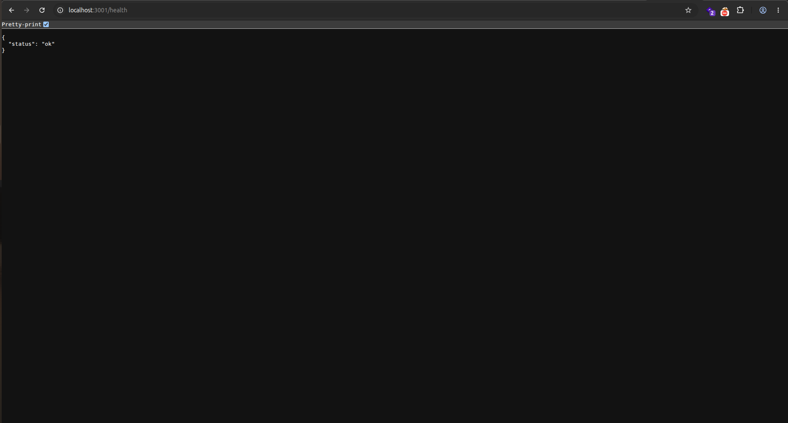

---

### 5. Alert sent to email after high cpu usage threshold

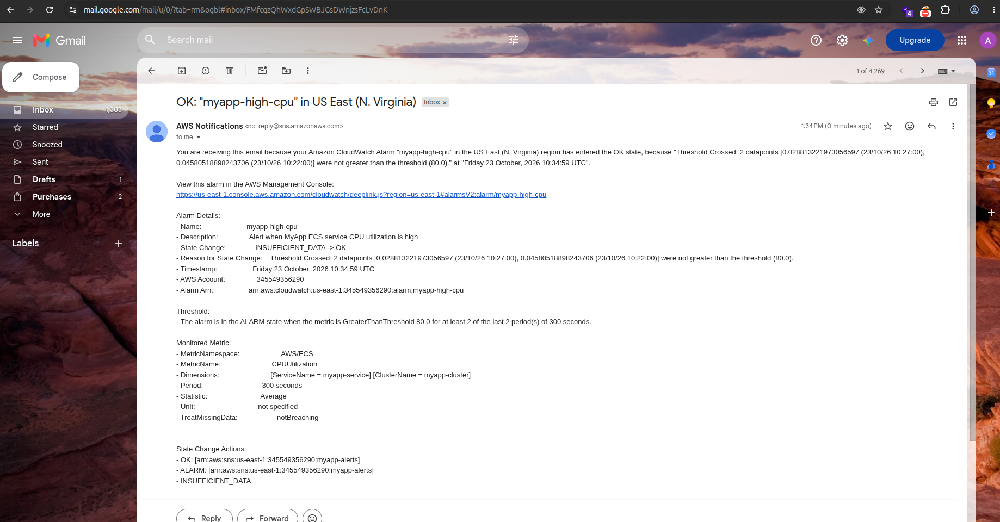

---


